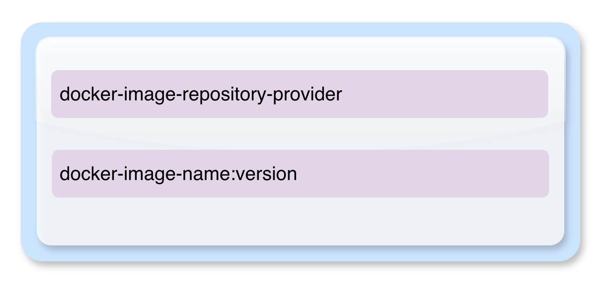

# Technical implementation

Build4Fun is a local web application with a Python backend and a browser editor
written in JavaScript and CSS. YAML files define the available blocks. The
backend saves projects, generates Compose output, and invokes the Docker CLI.
See the [user guide](../src/README.md) for installation and commands, and
[project purpose](purpose.md) for the educational goals.

## Runtime and installation

The [Dockerfile](../Dockerfile) builds an image containing Python, the application,
block templates, the Docker CLI, and the Compose plugin. The server listens on
`0.0.0.0:8080` inside the container. [compose.yaml](../compose.yaml) publishes that
port on `127.0.0.1`, mounts the workspace at `/workspace`, and mounts the host
Docker socket. Apprentice containers run on the host Engine alongside Build4Fun.
The health check requests the application's HTTP API.

[.env.example](../.env.example) documents the installation settings:

| Setting | Role |
| --- | --- |
| `B4F_HOST_WORKSPACE` | Absolute host directory corresponding to `/workspace`; defaults to `${PWD}/.workspace`. |
| `B4F_HTTP_PORT` | Published localhost port; defaults to `8080`. |
| `B4F_DOCKER_SOCKET` | Host Unix socket mounted inside the container; defaults to `/var/run/docker.sock`. |

Compose passes the published port to the backend as `B4F_PUBLIC_PORT` so its
Host checks accept the browser's port as well as the internal server port.
The backend accepts localhost and loopback Host values and rejects mismatched
Origin headers. This is a local application without multiuser authentication.
Access to the Docker socket grants control over the host Engine, so this setup
belongs in a trusted learning environment.

For native Python execution, the server binds to `127.0.0.1` by default and
accepts `--bind`, `--port`, and `--workspace` arguments. `B4F_DOCKER` can select
the Docker CLI executable. One server process should own each workspace.

## Source layout

| Path | Responsibility |
| --- | --- |
| `src/application/server.py` | HTTP routes, request checks, and application startup. |
| `src/application/core.py` | Definition registry, block validation, Compose assembly, and preview source mapping. |
| `src/application/references.py` | Resource and file references with stable identities. |
| `src/application/storage.py` | Workspace paths and file operations. |
| `src/application/projects.py` | Project listing, identity, naming, and deletion. |
| `src/application/revisions.py` | Atomic saves, revision conflicts, history, and restoration. |
| `src/application/export.py` | Portable project ZIP generation. |
| `src/application/docker_runtime.py` | Deployment planning, Docker validation, ownership checks, and lifecycle operations. |
| `src/application/static/` | Browser state, block editor, file explorer, map, preview, and styles. |
| `src/templates/` | YAML block definitions loaded at startup. |
| `src/tests/` | Unit, browser, Docker, and container checks with isolated fixtures. |

## Block model and Compose assembly

Each project is a tree rooted at a harness block. New projects contain a Project
name block and no services. Blocks have stable IDs, a type, a definition version,
input values, children, and optional references. The supported hierarchy is:

```text
Compose project
├── Project name
├── Service
│   ├── Image
│   ├── Ports
│   │   └── Port mapping
│   ├── Environment variables
│   │   └── Variable
│   ├── Mounts
│   │   ├── Volume mount
│   │   └── Bind mount
│   └── Network configuration
│       └── Network attachment
├── Named volume
├── Network
└── External network
```



Definitions in `src/templates/` specify inputs, allowed children, repeatability,
assembly targets, and operations. The registry supports `root`, `group`, `named`,
`set`, and `append` operations, with text, integer, choice, and boolean inputs.
Definitions load at startup; changes require restarting the Python server or
rebuilding and recreating the application container.

The generation path is:

**Definition YAML → validated block tree → assembled Compose document → YAML**

Group blocks organize entries without adding extra YAML sections. Variables
become environment entries, ports become list items, and mount and network
blocks connect services to their resources. Output orders `name`, `services`,
`networks`, and `volumes` consistently. Published ports use quoted short syntax.

The backend rejects invalid nesting, unsupported versions, duplicate names or
keys, missing references, and conflicting mount destinations. Network checks
cover IPv4 syntax, subnet membership, gateway conflicts, and duplicate static
addresses for managed networks. External network subnet membership is outside
the local block compiler's knowledge.

The registry currently supports definition version 1. It rejects missing or
unsupported definitions instead of substituting another version. Historical
definition versions and general definition migrations are not implemented.

## Editor and learning views

The application starts on the Projects landing page without selecting or
creating a project. The sidebar lists projects and a project-specific file tree.
Opening a project enters its builder. The block palette follows the selected
service or group; selecting Compose project returns to project-level additions.
Blocks can be added by click or drag, with a Move to action for keyboard use.

The Compose preview sits alongside the builder. Its source map links YAML lines
to blocks in both directions. Input editing uses the inspector; file editing uses
a plain-text editor with line numbers. Service file contents are not validated
or corrected, including files that happen to contain YAML.

The network map draws services connected to networks, host ports, named volumes,
and project files. Services without explicit attachments show the default
network. Shared resources appear once in the diagram. Selecting a service or
connection opens its block. The map reflects current blocks, including unsaved
edits; it does not inspect live Docker connectivity.

## Projects, references, and storage

Project display names are separate from Compose names and stable storage IDs.
The original workspace remains available as the legacy project. New projects
live under `.workspace/projects/<stable-id>/`. Compose names are unique across
saved projects and cannot change while a deployment exists. Renaming in the
project overview changes only the display name.

A save stages the block tree and file edits together under
`revisions/<revision-id>/`. An atomic `CURRENT` pointer selects the saved version.
A failed save leaves the previous version selected. Revision fingerprints detect
stale browser saves and return a conflict instead of overwriting newer work.
Saved versions can be reloaded or restored through the editor.

Resource references use block IDs when available. File references also have
persistent IDs, allowing explorer renames to update mount references and save
file drafts together. Unambiguous older name-based references are normalized.
Direct filesystem renames are not tracked automatically.

Switching projects preserves drafts, undo history, and explorer state in browser
memory. Unsaved blocks and file edits are also written to browser local storage,
scoped to the workspace. Reopening a project offers recovery or discard. Recovery
from an older saved revision preserves the conflict rather than silently
replacing the newer save. Browser storage availability and capacity limit this
recovery mechanism; Save project remains the durable storage action.

Saved-version controls can download a JSON draft backup before replacing local
edits. Importing that JSON or an exported Compose file is not implemented.
Revision history and deployment input copies have no automatic retention limit.
Workspace backups should include the complete workspace directory. Docker volume
data requires separate backup.

## Validation, review, and deployment

There are three distinct checks:

1. Block and assembly validation checks the project's structure and inputs.
2. Docker validation checks generated output with `docker compose config`.
3. Runtime status and logs report what Docker and the services actually did.

A successful preview does not guarantee Docker validation or service readiness.
Service errors remain visible as reported, without Build4Fun diagnosing file
contents.

Deploy is directly available in the builder. It saves blocks and file drafts,
then opens a change review. Start / Apply in Environment uses the same flow.
The review compares the saved project with the last deployment attempt and lists
added, removed, or changed services, configuration fields, networks, volumes, and
files. File comparisons use content hashes. Secret values are not displayed in
the review. Older deployment records without comparison data show a notice.

Deploy now checks that the reviewed revision remains current, validates the
configuration, and runs `docker compose up -d --remove-orphans`. Changes require
a fresh review if the project or its saved revision changes before deployment.
The review compares configuration snapshots; actual running state must be checked
through Environment status and logs.

Before applying, the backend checks ownership and host port conflicts. Managed
Docker resources carry a workspace ownership label. Commands use explicit
arguments, a fixed project directory, and an explicit Engine endpoint. Generated
deployments disable Compose's automatic `.env` loading. Docker operations are
serialized and have time limits.

## Deployment snapshots and persistent data

Each Apply copies saved files into a new `deployment-inputs/` directory. Bind
mounts reference this copy, so subsequent editor saves do not change files in a
running environment. Container writes to that copy are not carried forward to
the next Apply. Use named volumes for data that must survive redeployment.

Bind sources must exist within the project's files directory. Paths outside it
and symbolic links are rejected. Containerized installations use
`B4F_HOST_WORKSPACE` to translate paths into the host Engine's filesystem view.

The deployed Compose configuration, endpoint, saved revision, and comparison
state are recorded separately from the editor. Stop, status, logs, and removal
use that snapshot. The record is written before starting containers so a partial
or failed start remains manageable. After a timeout, inspect status because
Docker may have partially completed the operation.

Stop preserves containers and data. Remove deployment removes containers and
Compose-managed networks, while preserving named volumes, external networks, and
project files. Persistent-volume deletion is not offered. Remove a deployment
before deleting its project or changing its Compose name. Stopping Build4Fun
itself does not stop apprentice environments.

## Export and verification

Download compose.yaml exports only the preview. Export project saves the project
and creates a ZIP containing Compose output, the block project, project files,
and start instructions. Images, external networks, and Docker volume contents
are not included.

Unit tests cover assembly, references, persistence, revisions, networking, and
Docker controls. Browser checks use an isolated workspace and simulated Docker
operations, including draft recovery, map navigation, and deployment review.
Container checks verify HTTP access and Host/Origin checks. Real Docker lifecycle
checks are opt-in locally and run in CI alongside the other checks. Commands are
listed in the [user guide](../src/README.md#checks).

## Current boundaries

The application supports trusted local Unix-socket Engines and one server process
per workspace. It does not implement shared multiuser hosting, remote deployment,
free-form canvas positioning, service-file syntax highlighting, general
version migrations, backup import, automatic revision pruning, or guided exercise
grading. Service status refreshes on demand rather than continuously.
